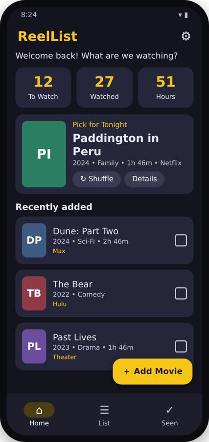
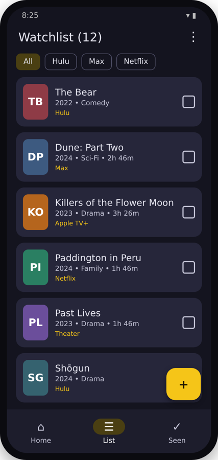
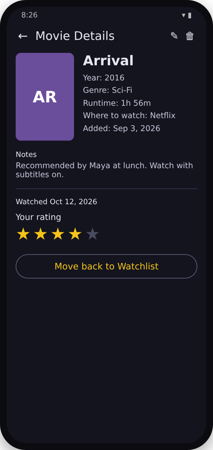
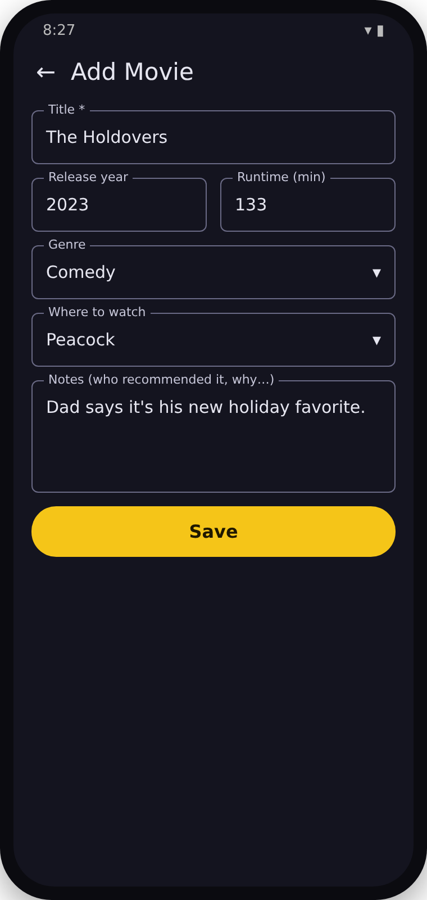
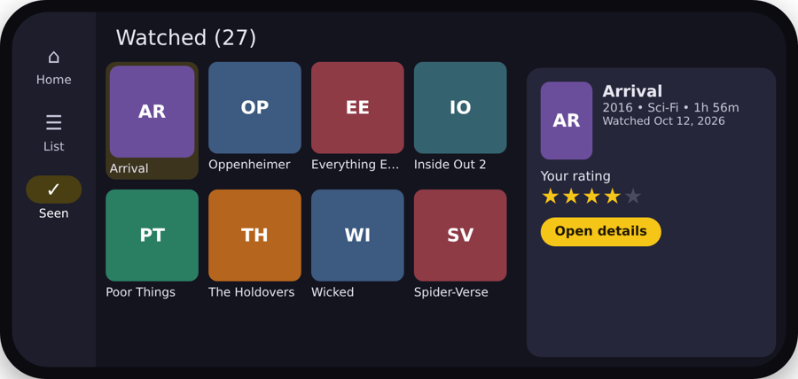
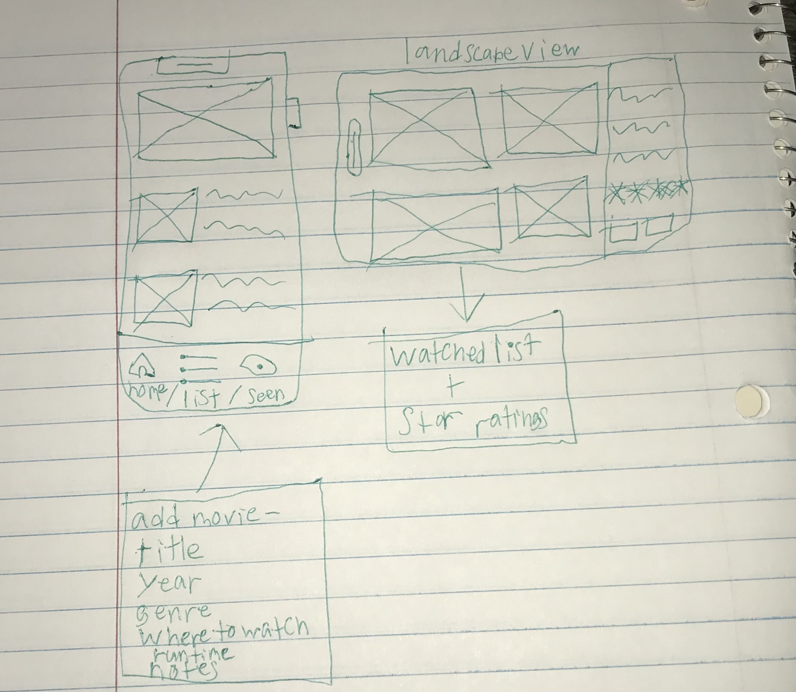
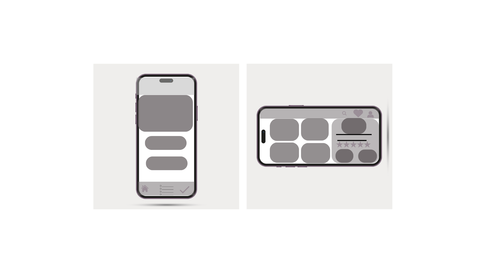

# ReelList

**College term project (COM-437): Android movie and TV watchlist app**
**Programmer:** *Your Name Here*
**Current version:** v0.3.1 (Project Submission 3, Module 6, Java edition)
**Repository:** https://github.com/Sion24/COM-437

## Goal
ReelList gives users one simple, private place to store every movie or show they plan to watch. It also tracks what they are watching now and what they have already finished. Users stop losing recommendations across screenshots, notes apps and four different streaming-service watchlists. They also spend less time scrolling menus trying to decide what to watch.

## Uses
Picture this: a friend recommends a movie at lunch, a trailer shows up on social media, or a title catches your eye on one streaming service. You can save it to ReelList in seconds. Only the title is required. The list belongs to you rather than to any single streaming service. Everything is stored on your phone, so ReelList works offline and needs no account.

Target users include casual movie and TV watchers, people who subscribe to several streaming services, film students and enthusiasts who track what they have seen, and families who want one list of what to watch together.

Anyone is welcome to look over the code, download it, and build it to test and experiment with. I will keep maintaining the main project while keeping the code readable and easy to modify.

## Screen Designs
| Home | Watchlist | Movie Details | Add Movie |
|---|---|---|---|
|  |  |  |  |

**Landscape (Watched screen):**


*These are design mockups of the v0.3.0 layouts (sample titles shown). They will be replaced with emulator screenshots in v1.0.0.*

### Wireframes
| Hand sketch (portrait + landscape) | Digital mockup |
|---|---|
|  |  |

## Project Outline
The full formal outline is published in the **[project Wiki](https://github.com/Sion24/COM-437/wiki)**. A summary follows.

**I. Project Description:** ReelList is an Android app for tracking movies and shows you want to watch, are watching, and have finished. Its target users are casual viewers, multi-service subscribers, film students and families.

**II. Problem Addressed:** Recommendations come from friends, social media, streaming services and notes apps, and get forgotten. ReelList is one platform-neutral list that belongs to the user, not to a streaming service.

**III. Platform:** Android 8.0+ phones (API 26–35), built in Android Studio with Java.

**IV. Front/Back End:** The front end uses XML layouts with Material Components (Material 3 theme) and has six screens, each a Fragment. The back end is a Room/SQLite database on the device. It stores title, year, genre, where to watch, runtime, notes, watched status, rating, date added and date watched.

**V. Functionality:** Add, edit and delete titles; sort and filter the list; mark titles watched; rate them 1–5 stars; see dashboard stats; get a "Pick for Tonight" random pick.

**VI. Design:** Same title bar / content / navigation pattern on every screen, with a Home / List / Seen bar. A checkbox always means "watched". Movie Details is the single editing hub. Landscape uses a poster grid with a rating panel.

**VII. Changes:** See the Update Log below and [Changelog.md](https://github.com/Sion24/COM-437/wiki/Changelog).

## Features (v0.3.1)
- **Home dashboard:** To Watch / Watched / Hours Watched counters, a "Pick for Tonight" random pick with a Shuffle button, and recently added and recently watched titles.
- **Watchlist:** unwatched titles, filter chips by streaming service (All, Netflix, Max…), sorting (date added, title, genre, service, runtime), and a checkbox to mark a title watched.
- **Watched history ("Seen"):** completed titles with a 1–5 star rating and the date watched.
- **Add / Edit Movie:** title, year, genre (dropdown), where to watch (dropdown, custom values allowed), runtime and notes, with input validation.
- **Movie Details (editing hub):** Mark as Watched, Rate, Edit and Delete all in one place, and Undo after a delete.
- **Settings:** default sort, "ask before deleting" toggle, and clear watched history.
- **Landscape layout:** a side navigation rail plus a poster grid. On the Seen screen, a rating panel sits beside the grid, matching the landscape wireframe.

## Navigation
```
Bottom bar (portrait) / side rail (landscape):  Home | List | Seen
Home ──► Add Movie ──► Movie Details
Home ──► Settings (gear icon)
List ──► Add Movie (+)  /  List ──► Movie Details
Seen ──► Movie Details
Movie Details ──► Mark Watched / Rate / Edit / Delete
```
Main screens are always one tap away. The user never has to press Back through several screens.

## Tech Stack
| Layer | Technology |
|---|---|
| Language | Java 17 |
| UI (front end) | XML layouts + Material Components (Material 3 theme), RecyclerView |
| Navigation | Jetpack Navigation component with Fragments (single Activity, XML nav graph) |
| State | AndroidViewModel + LiveData |
| Data (back end) | Room (SQLite on the device) + SharedPreferences for settings |
| Build | Gradle (Groovy DSL), Android Gradle Plugin 8.7 |
| Min / Target SDK | Android 8.0 (API 26) / Android 15 (API 35) |

## Project Structure
```
app/src/main/java/com/reellist/app/
├── MainActivity.java            # app entry point, bottom bar / side rail, Undo snackbar
├── data/                        # BACK END
│   ├── Movie.java               # database table (title, year, genre, service, runtime, notes, watched, rating, dates)
│   ├── MovieDao.java            # database queries (return LiveData)
│   ├── ReelListDatabase.java    # Room database
│   ├── MovieRepository.java     # single doorway for all data changes (background thread)
│   ├── MovieOptions.java        # genre and streaming-service lists
│   └── SettingsStore.java       # user preferences
├── logic/                       # plain Java rules (unit tested)
│   ├── WatchlistLogic.java      # sort, filter, stats, Pick for Tonight
│   ├── SortOption.java / WatchStats.java
│   └── MovieForm.java           # Add/Edit form validation
└── ui/                          # FRONT END
    ├── ReelListViewModel.java   # screen state shared by all screens
    ├── MovieAdapter.java        # RecyclerView list rows and poster grid
    ├── MovieViews.java          # poster tiles, star rating, date helpers
    └── screens/                 # Home, Watchlist, Watched, AddEditMovie, MovieDetails, Settings fragments
app/src/main/res/
├── layout/                      # portrait XML layouts (activity, fragments, list items)
├── layout-land/                 # landscape layouts (navigation rail, Watched grid + rating panel)
├── navigation/nav_graph.xml     # screen-to-screen navigation map
├── menu/, drawable/, values/    # toolbar menus, icons, colors, strings, theme
app/src/test/.../WatchlistLogicTest.java  # unit tests
docs/wireframes/, docs/screens/          # wireframes and screen designs
wiki/                                    # project outline pages for the GitHub Wiki
```

## How to Run
1. Install **Android Studio** (Ladybug or newer).
2. `git clone https://github.com/Sion24/COM-437.git`, then in Android Studio use **File ▸ Open** on the project folder.
3. Let Gradle sync, then press **Run ▶** on an emulator or a phone with USB debugging on.
4. Run the unit tests with `./gradlew test` (Windows: `gradlew.bat test`).

## Road Map
**|Now| (done in v0.3.0–v0.3.1)**
- Local Room database with the full movie record
- Add, edit and delete movies, with validation and Undo
- Watchlist with service filters and sorting; Watched history with 1–5 star ratings
- Home dashboard stats and "Pick for Tonight"
- Portrait bottom navigation and landscape rail/grid layouts

**|Next| (Modules 7–8)**
- Search box on the Watchlist
- "Currently Watching" status for shows (season/episode progress)
- Filter "Pick for Tonight" by service or by maximum runtime ("under 2 hours")
- Final app icon, screenshots and polish for the final submission

**|Later|**
- Optional movie lookup (title search with posters) through a public movie API
- Shared family lists and cloud backup
- Export/import of the list (CSV) and a home-screen widget
- Google Play release (internal testing track first)

## Update Log
See [CHANGELOG.md](https://github.com/Sion24/COM-437/wiki/Changelog) for the full version history.

**Latest update (v0.3.1):**
- Programming language switched from Kotlin to **Java**
- Jetpack Compose screens rebuilt as XML layouts + Fragments (Compose only works with Kotlin)
- Kotlin Flow replaced with LiveData; build scripts converted to the Gradle Groovy DSL
- All features and all 8 unit tests carried over unchanged

**Previous update (v0.3.0):**
- Android Studio project created and pushed
- Room database and repository added for local storage
- All six screens built: Home, Watchlist, Watched, Add/Edit Movie, Movie Details, Settings
- Landscape layout added to match the new landscape wireframe
- Unit tests added for sorting, filtering, statistics, random pick and form validation
